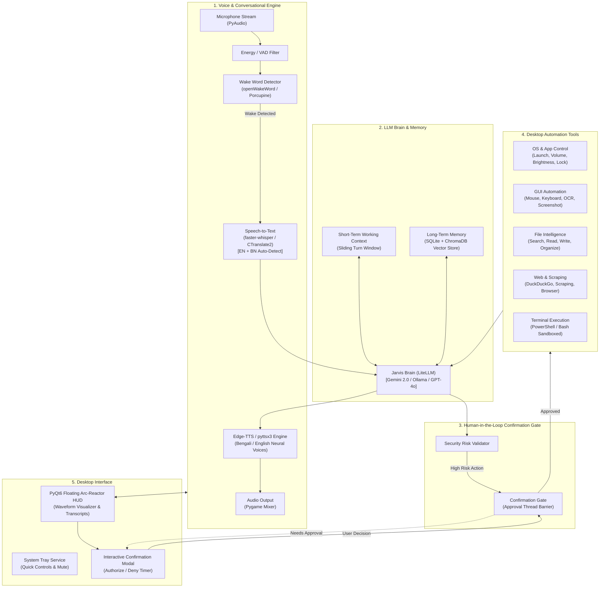

# J.A.R.V.I.S. Personal AI Desktop Assistant

An autonomous, locally hosted, full-duplex AI Desktop Assistant inspired by J.A.R.V.I.S. Designed with a modular multi-tier architecture featuring background wake-word listening, bilingual Speech-to-Text (English & Bengali), low-latency neural TTS, cognitive memory, tool-calling LLM reasoning (supporting both local Ollama and cloud APIs like Gemini/OpenAI), system automation, and a strict Human-in-the-Loop Security Gate.

---

## 🏛️ System Architecture



---

## 📁 Project Structure

```
personal_ai/
│
├── config.py                 # Core configuration, environment variables, dataclasses & defaults
├── requirements.txt          # Python dependencies with descriptions and optional GPU tags
├── .env.example              # Template environment variables (Keys, Models, Paths)
├── README.md                 # Architecture documentation and manual
│
├── main.py                   # Central orchestrator integrating Voice Engine, Brain, UI & Tools
├── voice_engine.py           # Root alias for voice engine
├── brain.py                  # Root alias for cognitive reasoning engine
├── memory.py                 # Root alias for short & long term memory
├── security.py               # Root alias for security & confirmation gate
├── tools.py                  # Root alias for tool registry & functions
├── ui.py                     # Root alias for PyQt6 HUD & System Tray
│
├── core/                     # Internal engine packages
│   ├── __init__.py
│   ├── voice_engine.py       # Audio capture, Wake Word, Faster-Whisper STT, Edge-TTS/pyttsx3
│   ├── brain.py              # LLM integration via LiteLLM (Ollama, Gemini, OpenAI), Tool Calling loop
│   ├── memory.py             # Short-term session & Long-term semantic/vector memory (SQLite + ChromaDB)
│   └── security.py           # Human-in-the-Loop Confirmation Gate, Risk Policy, Command Sanitizer
│
├── tools/                    # Modular Tool Suite
│   ├── __init__.py           # Tool registry, function schema generator for LLM
│   ├── system_tools.py       # OS, process management, power states, volume, brightness
│   ├── gui_tools.py          # Mouse/keyboard automation, screenshots, window management, OCR
│   ├── file_tools.py         # File search, read, write, organize, PDF/DOCX summarizer
│   ├── web_tools.py          # Web search (DuckDuckGo), live web scraping, browser automation
│   └── terminal_tools.py     # Sandboxed shell command execution with safety checks
│
├── ui/                       # Desktop UI Components
│   ├── __init__.py
│   └── ui.py                 # PyQt6 modern floating HUD widget, audio visualizer, status indicators
│
└── data/                     # Local storage (created automatically)
    ├── chroma/               # Persistent ChromaDB vector collections
    ├── screenshots/          # Saved desktop screenshots
    ├── audio_temp/           # Temporary audio chunks
    └── jarvis_memory.db      # SQLite relational database (user preferences, task logs)
```

---

## 🚀 Quickstart & Setup Guide

### 1. Prerequisites
- **Python**: Python 3.10 – 3.12 is recommended (tested with Python 3.11+).
- **FFmpeg**: Required for audio decoding and playback.
  - Windows: Run `winget install Gyan.FFmpeg` or download from [ffmpeg.org](https://ffmpeg.org/) and add to your system `PATH`.
- **Tesseract OCR (Optional, for screen reading)**:
  - Windows: Run `winget install UB-Mannheim.TesseractOCR` and add to `PATH`.

### 2. Environment Setup

Clone or open this workspace in terminal, then create and activate a virtual environment:

```powershell
# In PowerShell:
python -m venv .venv
.\.venv\Scripts\Activate.ps1
```

Install core dependencies:

```bash
pip install -r requirements.txt
```

> **Note for PyAudio on Windows:** If `pip install pyaudio` fails, run:
> `pip install pipwin; pipwin install pyaudio`

### 3. Configure Your Environment (`.env`)

Copy `.env.example` to `.env`:

```powershell
cp .env.example .env
```

Configure your LLM model:

#### Option A: Local Ollama (100% Offline & Private)
1. Download Ollama from [ollama.ai](https://ollama.ai).
2. Pull your model:
   ```bash
   ollama pull llama3.2
   ```
3. Update `.env`:
   ```ini
   LLM_PROVIDER=ollama
   LLM_MODEL=ollama/llama3.2
   OLLAMA_API_BASE=http://localhost:11434
   ```

#### Option B: Google Gemini API (Ultra-Fast & High Intelligence)
1. Get a Gemini API key from Google AI Studio.
2. Update `.env`:
   ```ini
   LLM_PROVIDER=gemini
   LLM_MODEL=gemini/gemini-2.0-flash
   GEMINI_API_KEY=your_gemini_api_key_here
   ```

---

## 🎙️ Core Capabilities

### 1. Full-Duplex Voice & Audio Engine
- **Wake Word Listening**: Continuously monitors the microphone in a non-blocking background thread. Trigger phrases: *"Hey Jarvis"*, *"Jarvis"*, or configurable custom wake phrases.
- **Bilingual Speech-to-Text (STT)**: Uses local `faster-whisper` (CTranslate2). Automatically detects whether you are speaking English or Bengali (`bn`), providing lightning-fast transcription with zero cloud latency.
- **Natural Neural TTS**: Uses Microsoft `edge-tts` to deliver ultra-natural responses:
  - English voice: `en-US-ChristopherNeural` (natural deep assistant tone)
  - Bengali voice: `bn-BD-PradeepNeural` (fluent Bengali speech)
  - Automatically switches voices depending on the response script.
  - Offline fallback to `pyttsx3` when no network is present.

### 2. Cognitive Memory Architecture
- **Working Memory**: Sliding 24-turn conversation window maintaining conversational state.
- **Relational Memory (SQLite)**: Stores explicit user preferences (e.g., preferred coding conventions, names, favorite apps) and historical task logs in `data/jarvis_memory.db`.
- **Vector Memory (ChromaDB)**: Embeds user instructions and facts, retrieving relevant context before queries are processed.

### 3. Tool Suite & System Automation
| Category | Tools | Capabilities |
| :--- | :--- | :--- |
| **OS & App Control** | `open_application`, `close_application`, `set_volume`, `get_volume`, `set_brightness`, `get_system_status`, `lock_workstation`, `system_power_control` | Launch apps, control sound, brightness, check CPU/RAM/Battery, lock or restart PC. |
| **GUI & Screen** | `take_screenshot`, `click_mouse`, `type_text`, `press_hotkey`, `get_active_windows`, `focus_window`, `read_screen_text` | Mouse & keyboard automation, OCR screen reading, window focus. |
| **File Intelligence**| `search_files`, `read_file_content`, `write_file_content`, `delete_file`, `organize_directory` | Search files, parse PDFs & DOCX, auto-categorize folder files into subdirectories. |
| **Web & Browsing** | `web_search`, `open_browser_url`, `scrape_webpage` | Real-time DuckDuckGo web searches, article text scraping, browser navigation. |
| **Terminal** | `execute_terminal_command` | Execute PowerShell/Bash commands with stdout/stderr capture and timeout protection. |

### 4. Human-in-the-Loop Confirmation Gate (Crucial Security)
Before executing any destructive action (e.g. deleting files, restarting or shutting down the machine, running `rm`/`del` terminal commands), J.A.R.V.I.S. pauses execution:
- Displays a prominent red warning dialog in the HUD with a 15-second countdown.
- Speaks a voice authorization prompt: *"Security confirmation required. Do you authorize this action?"*
- Requires explicit user approval via UI click or voice confirmation (*"Yes / Confirm"*).
- Auto-aborts and preserves system safety if rejected or timed out.

### 5. PyQt6 Futuristic HUD & System Tray
- Always-on-top, draggable, frameless translucent HUD inspired by the Iron Man Arc Reactor.
- **Waveform Visualizer**: Live animated frequency waves reflecting assistant states:
  - 🔵 **IDLE**: Gentle subtle wave.
  - 🔷 **LISTENING**: Bright glowing cyan wave responsive to mic input.
  - 🔶 **THINKING**: Pulsing amber wave during LLM tool-calling.
  - 🟢 **SPEAKING**: Dynamic emerald waveform synchronized with voice playback.
  - 🔴 **MUTED**: Minimized crimson alert wave.
- **System Tray Icon**: Right-click to show/hide the HUD, toggle mic mute, or cleanly terminate the assistant.
- **Dual Input**: Speak hands-free with the wake word or type commands directly into the HUD's bottom command bar.

---

## 🏃 Running the Assistant

Execute:

```bash
python main.py
```

1. The floating HUD appears in the bottom right corner of your desktop.
2. Say: **"Hey Jarvis"**
3. Speak any command:
   - *"What is my current CPU and memory usage?"*
   - *"Take a screenshot of my screen."*
   - *"Search the web for the latest SpaceX launch news."*
   - *"Open Notepad and type 'Meeting Notes: Project Alpha'."*
   - *"আজকের আবহাওয়া কেমন?"* (Bengali response supported!)
   - *"Organize my Downloads folder."*
   - *"Lock my workstation."*

---

## 🛡️ License
MIT License. Built for personal desktop autonomy and AI systems engineering.
